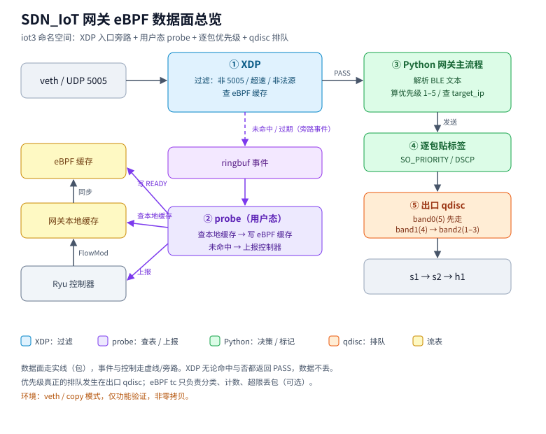

# eBPF 网关：filter + probe 维护流表 + priority 差异化发送

## 0. 范围（先划边界）

这个技能只描述三件事，其他一律不做：

1. **filter**：在 iot3 的入向 veth 上，用 XDP 在包进入内核协议栈和 Python 之前做分类、计数、按策略丢弃。
2. **probe**：XDP 发现“流表未命中 / 表项过期”时，通过 ringbuf 触发一次用户态探针；探针确认后把结果写回流表，让后续同类包不再触发探针。
3. **priority**：复用 `extensions/priority.py` 算出的 1–5 优先级，逐包打标记，配合出口 qdisc（或 DSCP + OVS `set_queue`），让高优先级数据在拥塞时先发。

**明确不做**（写了就是过度声明）：

- 不在 eBPF 里解析 BLE 文本、不维护 BLE 业务状态。
- 不在 eBPF 里计算传感器优先级（阈值和数值判断留在 Python）。
- 不在 eBPF 里转发数据（除非实现 XDP_REDIRECT + 重写，本版不做）。
- 不声称零拷贝 / 驱动级性能：本机物理网卡是 Wi-Fi（rtw89），不支持 native XDP；veth 只有 copy 模式。

执行规则：一次只推进一个阶段；需要 sudo 的命令交给用户执行并回贴输出；没有计数器或日志证据，不得写“已验证”。

### 总览图



文本版（便于复制和终端查看）：

```
                    ┌──────────────── iot3 网关 ─────────────────┐
BLE 数据             │                                             │
UDP 5005 ─► veth ───►│  ① XDP                                      │
                    │     ├─ 过滤：非5005 / 超速 / 非法源          │
                    │     └─ 查 eBPF 缓存                          │
                    │          │ 命中 ────────────────┐            │
                    │          │ 未命中               │            │
                    │          ▼                      │            │
                    │    ringbuf 事件                 │            │
                    │          │                      │            │
                    │          ▼                      │            │
                    │  ② probe（用户态）               │            │
                    │     ├─ 查网关本地缓存            │            │
                    │     │    命中 → 写 eBPF 缓存     │            │
                    │     └─ 未命中 → 上报控制器       │            │
                    │                 │               │            │
                    │                 ▼               ▼            │
                    │          ③ Python 网关主流程                │
                    │             解析 BLE 文本                   │
                    │             算优先级 1–5                    │
                    │             查 target_ip                    │
                    │                 │                          │
                    │                 ▼                          │
                    │          ④ 逐包贴标签                      │
                    │             SO_PRIORITY / DSCP             │
                    │                 │                          │
                    │                 ▼                          │
                    │          ⑤ 出口 qdisc                      │
                    │             band0：优先级5 → 先走          │
                    │             band1：优先级4                  │
                    │             band2：1–3 → 后走               │
                    └──────────────────┼──────────────────────────┘
                                       ▼
                                s1 → s2 → h1
```

| 编号 | 做什么 | 谁 |
|---|---|---|
| ① | 过滤、查缓存、按铃 | **XDP** |
| ② | 查表、补表、上报 | **probe（用户态）** |
| ③ | 解析 BLE、算优先级 | **Python** |
| ④ | 每个包贴标签 | **Python** |
| ⑤ | 排队、决定谁先走 | **qdisc** |

一句话：**入口 XDP 过滤和按铃，probe 查表补表，Python 决定优先级，包自己带标签，qdisc 排队放行。**

---

## 1. 三张表（不是 OSI 的二层/三层）

> 这里说的是三张**记录/缓存**：控制器表、网关本地缓存、eBPF 缓存。名字按机制取，避免和网络分层混淆。

| 表 | 位置 | 内容 | 谁写 | 作用 |
|---|---|---|---|---|
| **控制器表** | 控制器（Ryu） | OpenFlow 流表 | 控制器 | 全局决策 |
| **网关本地缓存** | 网关进程 Python `FlowTable` | FlowMod 解析结果 | `of_gateway_agent._on_flow_mod()` | 网关本地权威表 |
| **eBPF 缓存** | eBPF `flows` map | 入向 5 元组 → PENDING/READY + 过期时间 | probe | 探针抑制缓存（快路径） |

关系：**控制器表是权威，网关本地缓存是网关侧权威，eBPF 缓存只是缓存**。eBPF 缓存可以丢、可以重建，不能反过来覆盖网关本地缓存或控制器表。

“维护流表”具体指：probe 在 eBPF 缓存未命中时查网关本地缓存，命中就把 eBPF 缓存升级为 READY；网关本地缓存也没有才上报控制器，等 FlowMod 回来同时写网关本地缓存和 eBPF 缓存。

---

## 2. 两个职责的精确定义

### filter

- 挂载点：iot3 命名空间内、面向数据源的 veth（如 `iot3-eth0`）。
- 匹配：UDP `dport == 5005`。
- 默认策略：**只统计，不丢**。丢弃必须先看计数、再通过 `cfg` map 打开。
- 可做：非 5005 包计数/丢弃、每源 IP 限速、ringbuf 满时计数。

### probe

触发条件只有两个：eBPF 缓存没有表项，或表项已过期。并且必须同时满足：

- 每个 key 有冷却时间（建议 1 s）；
- 全局有探针速率上限（建议 50 次/s）。

probe 的职责是**确认这条流该怎么走**，不转发、不改包：

1. 查网关本地缓存；
2. 网关本地缓存命中 → 写 eBPF 缓存 = READY，不发控制器；
3. 网关本地缓存未命中 → 通过现有 OF 客户端上报控制器（PacketIn / extension 上报）；
4. 收到 FlowMod → 写网关本地缓存 → 写 eBPF 缓存 = READY；
5. 任何一步失败 → 计数 + 退避，数据仍然 `XDP_PASS` 交给 Python，不能因为 probe 挂了丢数据。

---

## 3. 端到端时序

```
 包 ─► veth ─► [XDP]
                 ├─ eBPF 缓存命中 ─────────────► XDP_PASS ─► Python
                 │
                 └─ 未命中 / 过期 ─► ringbuf ─► probe（用户态）
                                                    │
                                       查网关本地缓存
                                          ├─ 命中 → 写 eBPF 缓存（READY）
                                          └─ 未命中 → 上报控制器
                                                          │ FlowMod
                                                          ▼
                                            写网关本地缓存 → 写 eBPF 缓存
```

四种典型序列：

1. **首包**：miss → 1 次 ringbuf 事件 → 1 次上报 → 1 条 FlowMod → 网关本地缓存和 eBPF 缓存各 1 条。
2. **后续包**：eBPF 缓存命中 → 0 次事件、0 次上报。
3. **过期**：eBPF 缓存表项过期 → 下一包重新触发 1 次 probe（不是每包）。
4. **控制器不可达**：probe 退避重试，数据继续 PASS；不丢包、不崩溃。

---

## 4. 已核对的现状与偏差（实现前必须看）

| 事实 | 位置 | 对设计的影响 |
|---|---|---|
| 网关在用户态解析 BLE 文本并 `sendto` 转发 | `gateway/iot_gateway_enhanced.py:251-308` | 数据转发仍在 Python；eBPF 不做转发 |
| BLE 地址 → 目标 IP 是硬编码 if/elif | `iot_gateway_enhanced.py:265-272` | probe 可以做这个映射，或把映射下沉到配置 |
| 本地流表查询用 `dst_ip=target_ip` | `gateway/core/of_gateway_agent.py:127` | 网关本地缓存的 key 是“目标 IP”，不是入向包的 5 元组 |
| 控制器给 dpid=3 下发的流匹配 `ipv4_dst=target_ip` | `ryu_extend/switch/Other_Modules/packet_processor.py:214` | **入向 5005 包的 dst 是网关自己**，这条流不会命中它；eBPF 缓存必须用入向 5 元组做 key |
| 扩展流的 match 只有 `ipv4_dst`，不同优先级共用同一个 match | `packet_processor.py:214-220` | 高优先级流会盖住低优先级流；所有去同一目标的流量只走最高优先级那条，优先级并未逐包生效 |
| 网关 OF 客户端只保存 FlowMod，不参与本地发包 | `gateway/core/of_gateway_agent.py:262-269` | 给 dpid=3 下发的流不改变网关 `sendto` 的数据面 |
| `_on_packet_out` 只记录，不转发 | `gateway/core/of_gateway_agent.py:262-269` | 不要指望 PacketOut 推动数据面 |
| 现有上报有 5 s 去重 | `gateway/core/of_gateway_agent.py:137-140` | probe 的 BPF 冷却可以替代或叠加它，避免双重限速 |
| 控制器扩展流 `idle_timeout=60` | `packet_processor.py:222-223` | eBPF 缓存 TTL 建议同为 60 s，保持一致 |

**核心结论**：eBPF 缓存的 key 必须是**入向 5 元组**（`src_ip, dst_ip=网关, sport, dport=5005, proto`），probe 再根据 payload 前缀把 BLE 地址翻译成 target_ip 去查网关本地缓存。不要假设网关本地缓存/控制器表的 `ipv4_dst` 匹配能直接复用到 eBPF 缓存。

payload 前缀约定：5005 的负载形如 `<ble_addr>,<type>,<value>`，BLE 地址占 17 字节 + 逗号。XDP 只拷贝固定长度预览（建议 24 字节）放进事件，**不在 XDP 里解析字符串**。

---

## 5. 数据结构

### eBPF maps

| map | 类型 | key | value | 说明 |
|---|---|---|---|---|
| `flows` | HASH | `struct flow_key`（5 元组） | `{expires_ns, flags}` | flags: 0=PENDING，1=READY |
| `misses` | RINGBUF | — | `struct miss_evt` | key + 时间戳 + payload 预览 |
| `cfg` | ARRAY | `u32[0]` | `u32` | 0=只统计，1=丢弃非 5005 |
| `stats` | PERCPU_ARRAY | 计数键 | `u64` | 分类/命中/未命中/ringbuf 满 |

### 状态机

```
        ┌──────────┐   probe 确认 / 网关本地缓存命中   ┌─────────┐
  miss ─► PENDING  │ ───────────────────────► │  READY  │
        │ (冷却中) │                          │ (TTL)   │
        └──────────┘                          └────┬────┘
             ▲                                     │ TTL 到期
             └─────────────────────────────────────┘
```

- PENDING：已经发过事件，冷却期内不再发。
- READY：探针已确认，正常放行，不再发事件。
- 表项过期后视同 miss，重新走一轮。

---

## 6. XDP 程序骨架（libbpf 风格，示意，未编译验证）

```c
// gateway/xdp/gw_filter_probe.c
#include <linux/bpf.h>
#include <linux/if_ether.h>
#include <linux/ip.h>
#include <linux/udp.h>
#include <bpf/bpf_helpers.h>
#include <bpf/bpf_endian.h>

#define UDP_PORT 5005
#define COOLDOWN_NS (1ULL * 1000 * 1000 * 1000)
#define PREVIEW_LEN 24

struct flow_key {
    __u32 saddr, daddr;
    __u16 sport, dport;
    __u8  proto;
    __u8  pad[3];
};

struct flow_val {
    __u64 expires_ns;
    __u32 flags;          // 0=PENDING, 1=READY
    __u32 pad;
};

struct miss_evt {
    struct flow_key key;
    __u64 ts_ns;
    __u8  preview[PREVIEW_LEN];
};

struct {
    __uint(type, BPF_MAP_TYPE_HASH);
    __uint(max_entries, 8192);
    __type(key, struct flow_key);
    __type(value, struct flow_val);
} flows SEC(".maps");

struct {
    __uint(type, BPF_MAP_TYPE_RINGBUF);
    __uint(max_entries, 1 << 18);
} misses SEC(".maps");

struct {
    __uint(type, BPF_MAP_TYPE_ARRAY);
    __uint(max_entries, 1);
    __type(key, __u32);
    __type(value, __u32);
} cfg SEC(".maps");

struct {
    __uint(type, BPF_MAP_TYPE_PERCPU_ARRAY);
    __uint(max_entries, 8);
    __type(key, __u32);
    __type(value, __u64);
} stats SEC(".maps");

static __always_inline void bump(__u32 k)
{
    __u64 *v = bpf_map_lookup_elem(&stats, &k);
    if (v) __sync_fetch_and_add(v, 1);
}

SEC("xdp")
int gw_filter_probe(struct xdp_md *ctx)
{
    void *data = (void *)(long)ctx->data;
    void *data_end = (void *)(long)ctx->data_end;
    __u64 now = bpf_ktime_get_ns();

    struct ethhdr *eth = data;
    if ((void *)(eth + 1) > data_end) return XDP_PASS;
    if (bpf_ntohs(eth->h_proto) != ETH_P_IP) { bump(0); return XDP_PASS; }

    struct iphdr *ip = (void *)(eth + 1);
    if ((void *)(ip + 1) > data_end) return XDP_PASS;
    if (ip->protocol != IPPROTO_UDP) { bump(1); return XDP_PASS; }

    __u32 ihl = (__u32)ip->ihl * 4;
    if (ihl < sizeof(*ip)) return XDP_PASS;
    struct udphdr *udp = (void *)ip + ihl;
    if ((void *)(udp + 1) > data_end) return XDP_PASS;

    // 非 5005：按 cfg 决定丢不丢
    if (bpf_ntohs(udp->dest) != UDP_PORT) {
        bump(2);
        __u32 k = 0;
        __u32 *drop = bpf_map_lookup_elem(&cfg, &k);
        return (drop && *drop == 1) ? XDP_DROP : XDP_PASS;
    }

    struct flow_key key = {
        .saddr = ip->saddr, .daddr = ip->daddr,
        .sport = udp->source, .dport = udp->dest,
        .proto = IPPROTO_UDP,
    };

    struct flow_val *v = bpf_map_lookup_elem(&flows, &key);
    if (v && v->expires_ns > now) { bump(3); return XDP_PASS; }

    // 未命中/过期：写 PENDING 做冷却，然后发一个事件
    struct flow_val pending = { .expires_ns = now + COOLDOWN_NS, .flags = 0 };
    bpf_map_update_elem(&flows, &key, &pending, BPF_ANY);

    struct miss_evt *e = bpf_ringbuf_reserve(&misses, sizeof(*e), 0);
    if (!e) { bump(6); return XDP_PASS; }   // ringbuf 满：不丢数据
    __builtin_memset(e, 0, sizeof(*e));
    e->key = key;
    e->ts_ns = now;
    __u8 *p = (void *)udp + sizeof(*udp);
    if ((void *)(p + PREVIEW_LEN) <= data_end)
        __builtin_memcpy(e->preview, p, PREVIEW_LEN);
    bpf_ringbuf_submit(e, 0);

    bump(4);
    return XDP_PASS;    // 数据继续交给 Python，probe 只做控制
}

char _license[] SEC("license") = "GPL";
```

实现选型（已定）：

- **Go + cilium/ebpf（当前）**：数据面 C 用 libbpf 写法，Go 负责加载、ringbuf、map 回写；
  实现见 `gateway/xdp/goprobe/`（`make` 后得到单二进制），自测 `selftest_go.sh` /
  `selftest_go_probe.sh`。
- 历史：BCC/Python 加载器已移除；原 libbpf + clang 选项由 Go 加载器覆盖。

---

## 7. probe 伪代码

```python
# 独立探针进程；与网关进程通过 Unix datagram 通信
# 网关进程是唯一的 OF 客户端，探针不直接连控制器
PROBE_SOCK = "/tmp/sdn_xdp_probe.sock"

def consume_miss(evt):
    key = tuple(evt.key)                     # 5 元组
    if global_rate_exceeded():               # 全局 50/s
        return
    # 1) 问网关：payload 前缀对应哪个 target_ip？
    reply = unix_call(PROBE_SOCK, {
        "op": "resolve",
        "preview": evt.preview.hex(),
        "key": key,
    })
    # 2) 网关查网关本地缓存：命中则只回写 eBPF 缓存；未命中则网关自己走 OF 上报
    if reply["status"] == "ready" and reply.get("ttl", 0) > 0:
        update_flow_map(key, flags=1, expires=now_ns() + reply["ttl"] * 1e9)
    # status == "pending"：网关已上报控制器，等 FlowMod；
    # 网关收到 FlowMod 后再通知探针写 eBPF 缓存
```

网关侧新增一个 Unix socket 处理线程：

1. 收 `resolve`：用 payload 前缀取出 BLE 地址，按现有映射得到 `target_ip`；
2. 查网关本地缓存（`self.of_agent.flows.lookup(dst_ip=target_ip, eth_type=0x0800)`）；
3. 命中 → 返回 `ready` + 剩余 TTL；
4. 未命中 → 调现有 `_report_to_openflow()` 上报，返回 `pending`；
5. `_on_flow_mod()` 成功写入网关本地缓存后，主动推送 `flow_ready(key, ttl)` 给探针。

这样 **OF 客户端仍然只有一个**，探针只负责 eBPF 缓存。

---

## 8. 一致性、限速、老化、故障

| 主题 | 规则 |
|---|---|
| 写顺序 | 先网关本地缓存，再 eBPF 缓存；eBPF 缓存写失败只计数，不回滚网关本地缓存 |
| 删除 | 控制器删除流 → 网关本地缓存删除 → 通知探针删除 eBPF 缓存对应项 |
| 重启 | 网关启动后用网关本地缓存重建 eBPF 缓存；控制器表重连后以 FlowMod 为准 |
| 冷却 | 每 key 1 s；全局 50 次/s；超限只计数 |
| TTL | 与控制器扩展流 `idle_timeout=60` 对齐；避免 eBPF 缓存比控制器表活得更久 |
| ringbuf 满 | `bpf_ringbuf_reserve` 失败 → `stats[6]++`，包照常 PASS |
| 控制器断连 | probe 退避（1s/2s/4s，上限 30s），数据不丢 |
| map 满 | 新 key 写不进去 → 计数并回退到 Python 查表，不阻塞数据面 |

---

## 9. 验收用例（没有这些数字不算完成）

| 编号 | 操作 | 通过标准 |
|---|---|---|
| T1 | 向 5005 注入 1000 包 | `stats[3/4]` 合计 = 1000；Python 收到 1000 |
| T2 | 清空 `flows`，注入第 1 包 | 恰好 1 次 ringbuf 事件、1 次上报、1 条 eBPF 缓存 |
| T3 | 继续注入 1000 包 | 新增事件 = 0，新增上报 = 0 |
| T4 | TTL=5 s，等待后注入 | 重新出现 1 次事件，不是每包一次 |
| T5 | 停控制器后注入 | 网关不崩溃、数据仍转发；重试日志有退避 |
| T6 | 1 s 内注入 1000 个不同 key | 上报次数 ≤ 配置上限（默认 50） |
| T7 | 打开 cfg 丢弃非 5005 | `stats[2]` 增长，`stats[3]` 不受影响 |

测量项：eBPF 缓存命中率、事件数、控制器上报数、Python 处理 pps、CPU（`pidstat`）、丢包（`nstat -az UdpRcvbufErrors`）。所有性能结论必须注明“veth / copy 模式”。

---

## 10. 实施顺序

1. **只做 filter**：挂 XDP、跑 `stats`，确认不影响现有网关。
2. **只发事件**：加 ringbuf 和 PENDING 冷却，事件只打日志，不写表。
3. **网关本地缓存 → eBPF 缓存**：探针查到网关本地缓存时写 READY，验证 T3。
4. **控制器回路**：网关本地缓存未命中 → 上报 → FlowMod → 双写。
5. **老化与限速**：TTL、每 key 冷却、全局上限。
6. **priority**：先按路线 A 逐包写 `SO_PRIORITY`，再补网关出口 qdisc，最后在拥塞下测 T8–T10；路线 B 等 A 跑通再评估。
7. **测量**：基线 vs 改后，填进报告。

每一步都必须能独立回滚：`sudo ip link set dev <iface> xdp off`。

---

## 11. 简历 / 报告措辞边界

可以写：

- “在网关入向 veth 上用 XDP 过滤 UDP 5005，未命中流表时通过 ringbuf 触发用户态探针，探针与 OpenFlow 控制器协同维护 5 元组流表缓存。”
- “按 1–5 优先级逐包标记，结合出口 qdisc 在拥塞时优先发送气体/移动类数据，并给出高/低优先级延迟对比。”
- 数字：事件数、命中率、上报次数下降比例、Python 处理 pps/CPU、两类包的延迟。

不能写：

- “eBPF 实现转发 / 零拷贝 / 内核旁路”——本版没有做。
- “网关数据面下沉内核”——BLE 路径仍在 Python。
- “eBPF 根据传感器类型计算优先级”——类型和阈值判断在 Python。
- “OpenFlow Experimenter 优先级改变了发送顺序”——当前 Experimenter 动作是 no-op，真正生效的是 SO_PRIORITY/DSCP + qdisc。
- 未注明环境的性能数字——必须写 veth、copy 模式。

---

## 12. priority（差异化发送）

**目标**：拥塞时，气体/移动类（优先级 5）先于普通温度（优先级 2）发出。

### 12.1 三个必须先承认的事实

1. **优先级只在有排队时才有意义**。链路空闲时所有包立即发出，高/低优先级延迟一样；在空闲链路上宣称“高优先级更快”是造假。
2. **优先级决策在 Python**。`extensions/priority.py::calculate_priority()` 要看传感器类型和数值（温度阈值等），eBPF 看不到 BLE 文本，算不了。eBPF/tc 只负责执行、分类和计数。
3. **同一对源/目的的消息共享 5 元组**。气体和温度都从网关发往 `h1:5005`，5 元组完全相同，不能靠 flow map 区分。优先级必须**逐包携带**（`skb->priority` 或 DSCP），不能只写进流表。
4. **现在的实现把优先级写成了流表项优先级**。`install_extension_flow()` 的 match 只有 `ipv4_dst=target_ip`，气体和温度装进去是同一个 match、不同 priority。高优先级那条会把低的盖住，导致“所有去该目标的流量”共用一个优先级。这不是逐包 QoS，只是流表项排序。

### 12.2 职责划分

| 事情 | 谁负责 | 说明 |
|---|---|---|
| 判断优先级（气体=5，温度=2） | Python `priority.py` | eBPF 看不到 BLE 文本 |
| 逐包打标记 | Python 发送前 `SO_PRIORITY` / `IP_TOS(DSCP)` | 标记必须跟着包走 |
| 入口过滤 / 触发 probe | XDP | 与优先级无关 |
| 出口分类、计数、超限丢包 | eBPF `tc egress`（可选） | 不做真正的调度 |
| 决定谁先出队 | qdisc（prio / HTB） | 真正让高优先级先走的是它 |

一句话：**Python 决定，包带标记，eBPF 分类，qdisc 排队。**

### 12.3 实现路径

先选路线：

- **路线 A（推荐先做）**：只改网关。逐包 `SO_PRIORITY` + 网关出口 qdisc；流表完全不动；Experimenter 里的 priority 只作上报元数据。
- **路线 B（让 SDN 参与）**：逐包设 DSCP → s1/s2 按 `ip_dscp` 匹配并 `set_queue`。需要 OVS 端口先配好 HTB 队列；扩展流的 match 要带上 `ip_dscp`，否则又会互相遮盖。

**路线 A 第 1 步：逐包打标记（必须）**

`forward_data()` 现在每条消息新建 socket 再 `sendto`（`gateway/iot_gateway_enhanced.py:295-308`），在发送前加：

```python
sock.setsockopt(socket.SOL_SOCKET, socket.SO_PRIORITY, priority)   # 1–5，≤6 不需要额外权限
```

或：

```python
sock.setsockopt(socket.IPPROTO_IP, socket.IP_TOS, dscp << 2)       # DSCP 占 TOS 高 6 位
```

优先级直接复用 `encode_openflow_extension()` 已经算好的 `device_priority`，不要再写一套阈值。

**路线 A 第 2 步：出口队列调度（必须）**

在发往 h1 的接口上（通常是 `iot3-eth3`，运行在 iot3 命名空间内）加 classful qdisc：

- `prio`：3 个 band，自定义 priomap 把 `skb->priority` 5→band0、4→band1、1–3→band2。实现简单，适合演示。
- `htb`：高/低两个 class，`tc filter` 按 DSCP 或 priority 分类；能提供带宽保证，适合更真实的过载场景。

注意：`tbf` 这类无类 qdisc 只有一条 FIFO，**不会让优先级生效**。

**路线 B：DSCP + OVS set_queue**

1. 网关逐包设置 DSCP（`IP_TOS`）；不要用 `SO_PRIORITY`，因为交换机看不到它。
2. s1/s2 安装按 `ip_dscp` 匹配的流，动作用 `set_queue:<queue_id>`；扩展流本身也要带上 `ip_dscp`，或者让 DSCP 流的优先级更高，否则会被只按 `ipv4_dst` 匹配的扩展流盖住。
3. OVS 端口先配好 HTB 队列（`ovs-vsctl set port ... qos=... queues=...`）；没有队列时 `set_queue` 没有意义。
4. 注意排队发生在 s1/s2 的出口；网关 `eth3` 到 s1 这一段没有按优先级排队。

**第 3 步（可选）：eBPF tc egress 增值**

- 在出口挂 `tc egress` 程序，读 `__sk_buff.priority` / DSCP，做每类计数、超限 policing、必要时用 map 动态调策略。
- 如果目标只是“高优先级先走”，标准 tc qdisc 已经足够；不要把这件事写成“eBPF 实现优先级调度”。

### 12.4 演示条件

1. 用 HTB/prio + 限速制造真实排队（例如出口限 1–5 Mbit），或同时注入超过带宽的流量。
2. 在 h1 上起 UDP 5005 监听，记录到达顺序和时间戳。
3. 同时注入 `gas,100`（优先级 5）和 `temp,25`（优先级 2）。
4. 对比两类包的**平均延迟、最大延迟、到达顺序**，以及 `tc -s qdisc show dev iot3-eth3` 的分 band 计数/backlog。

### 12.5 验收

| 编号 | 操作 | 通过标准 |
|---|---|---|
| T8 | 空闲链路注入两类包 | 两类延迟无明显差异（如实记录，不能伪造优势） |
| T9 | 限速制造拥塞后重复注入 | 高优先级平均/最大延迟低于低优先级；band 计数符合预期 |
| T10 | 去掉 qdisc 重复 T9 | 差异消失，证明差异来自调度 |

### 12.6 边界与措辞

- 可以写：“按 1–5 优先级逐包标记，结合出口 qdisc 在拥塞时优先发送高优先级数据，高/低优先级平均延迟分别为 X/Y ms。”
- 不能写：“eBPF 根据传感器类型计算优先级”（在 Python）。
- 不能写：“OpenFlow Experimenter 优先级改变了发送顺序”（当前动作是 no-op）。
- 不能写：“priority 决定流表项优先级”等于“差异化转发”——那只是让某条流先匹配，流量仍走同一个出口、同一个队列。
- 路线 B 里扩展流如果只匹配 `ipv4_dst`，会盖住 `ip_dscp` 流；要么让扩展流带上 `ip_dscp`，要么提高 DSCP 流的优先级。
- 路线 B 的排队发生在 s1/s2 出口；网关 `eth3` 到 s1 这一段没有按优先级排队。
- 没有拥塞数据，就不要写“高优先级先发”。

## 13. 评审决策点（需要用户确认）

1. filter 的 key 用入向 5 元组，还是再加 payload 前缀（BLE 地址）？建议先 5 元组。
2. 未命中时包是 `PASS` 还是 `DROP`？建议 `PASS`，保证不丢数据。
3. probe 放独立进程还是网关进程内？建议独立进程 + Unix socket，避免 venv 与 bcc 的 Python 版本冲突。
4. 网关本地缓存和 eBPF 缓存谁是权威？建议网关本地缓存权威、eBPF 缓存可重建。
5. TTL 和冷却值是否按 60 s / 1 s / 50 次每秒？
6. 是否要保留现有 5 s 去重，还是完全交给 BPF 冷却？
7. 本版是否接受“eBPF 不转发、只过滤和触发”这个定位？接受则简历措辞按第 11 节写。
8. 走路线 A（网关本地 `SO_PRIORITY` + qdisc）还是路线 B（DSCP + s1/s2 `set_queue`）？建议先 A，测出差异后再评估 B。
9. 优先级标记用 `SO_PRIORITY` 还是 DSCP？路线 A 两者都行；路线 B 必须用 DSCP。
10. 出口 qdisc 放在网关（路线 A）还是 OVS 端口（路线 B）？演示用网关 `prio` 最简单。
11. egress 是否还要挂 eBPF 做分类计数，还是先用 `tc -s qdisc`？建议先 `tc -s`，避免为了 eBPF 而 eBPF。
